# Roadmap

Where Those Who Run is going and in what order. GitHub milestones and issues
are the source of truth for the details. Each milestone is a release, each
release below links to its milestone, and every open issue carries a `stream:`
label so a stream can be worked on its own.

Last reviewed 2026-10-20, after 0.7.5 shipped: rows for the 0.6.x patches,
0.7.5, 0.7.6 Track map and 0.11.1 Observability, the order from 0.7.6 on, the
web app in its own repo (#347) in Decided, and the table checked against every
milestone's issues. The review before was on 2026-10-18, when the releases
were cut down to the smallest
that still ship something whole, so changes ship quickly. Earlier
the same day, after the UI decision (ADR 0003), 0.6 was cut down to the MVP
and the rest of its foundations moved to the release that first needs each
one. The review before was on 2026-10-17, at release 0.4.0, after a code
review and an architecture review of the same day.

## Principles

1. **Own car only.** GT7 sends nothing about other cars, flags, penalties,
   weather or tyre wear. Every feature works from our own car's telemetry, or
   it is not on the list.
2. **Voice first, eyes on the road.** In VR the engineer is the HUD: never talk
   mid-corner, never repeat the same sentence.
3. **Numbers before words.** Measurements are computed deterministically and
   tested on real recordings. AI only phrases, prioritises and answers, and
   never invents a number.
4. **Local first.** Everything runs on your own hardware; a cloud model is
   optional and off by default.
5. **Pinned by a recording.** A behaviour ships with a fixture from a real
   drive.

## Releases

From 0.5 on, each milestone is a minor release, cut when its issues are
closed; fixes in between ship as patch releases. Releases are as small as they
can be while still shipping something whole: one theme, usually three to
eight issues, that can ship in days. A release depends only on the ones before
it (checked against every issue's "Blocked by" line on 2026-10-18).

| Release | What it delivers |
|---|---|
| [0.5 Solid ground](https://github.com/those-who-run/those-who-run/milestone/19) | The bugs from the code review fixed, including the stored best lap (#185). Guardrails: `make check` with type checking, reproducible builds, release checks, deterministic tests, gzipped fixtures. The pit wall deployed, after the data and network decisions (#194). An archive for the outings specs rely on (#197). The 0.5.x patches (#260). Shipped. |
| [0.6 Runtime and API server](https://github.com/those-who-run/those-who-run/milestone/20) | **The MVP, part one.** CLI commands in their own modules (#171), a runtime object that owns the live engineer (#172), and an API server on the engineer's event loop (#173). Sessions that stay right through a pause (#229) and a restart on lap 1 (#157). Shipped, then three patch releases. **[0.6.1 Track detection fixes](https://github.com/those-who-run/those-who-run/milestone/42):** twin layouts named by their circuit, and a loading screen that no longer wipes the track (#275). **[0.6.2 Safe deploys](https://github.com/those-who-run/those-who-run/milestone/41):** deploy only when the engineer is idle (#272), and a mid-race restart continues the same session (#273). **[0.6.3 GitOps and release automation](https://github.com/those-who-run/those-who-run/milestone/43):** merged PRs collect in one release PR that ships when merged (#286), and a published release bumps the deployment's manifest (#287). |
| [0.7 React pit wall](https://github.com/those-who-run/those-who-run/milestone/26) | **The MVP, part two**, in five small releases, then two more after it, to [ADR 0003](docs/adr/0003-ui-stack.md) and [ADR 0004](docs/adr/0004-design-language.md) (the design language, #291). **0.7.0:** the read-only data API that proxies the engineer (#236), the engineer's status route (#292), and the web scaffold with a device preview from the laptop (#237). A deployment keeps one pit wall, Streamlit, until 0.7.4 switches it. **[0.7.1 Design system](https://github.com/those-who-run/those-who-run/milestone/44):** tokens, fonts and one formatter shared with Python (#294), the component kit on `/_kit` (#295), the app shell with the live engineer chip (#296). **[0.7.2 Sessions](https://github.com/those-who-run/those-who-run/milestone/45):** the session list (#297) on its API (#318) and the session page (#298). **[0.7.3 Lap compare](https://github.com/those-who-run/those-who-run/milestone/46):** compare on uPlot (#299) and the race-story chart (#300). **[0.7.4 Streamlit retired](https://github.com/those-who-run/those-who-run/milestone/47):** the cut-over in place (#238). 0.7.0 to 0.7.4 shipped. **[0.7.5 Docs and guardrails](https://github.com/those-who-run/those-who-run/milestone/48):** the docs as guides with diagrams and screenshots (#333, #334, #336), checks that keep the docs and the code in step (#338), commit hooks agents can't skip (#339), agent settings and the AI policy (#352, #359), and supply-chain checks in CI (#354, #355, #356, #357, #358, #360). Shipped. **[0.7.6 Track map](https://github.com/those-who-run/those-who-run/milestone/50):** the car's position in the lap trace (#349) and the track map on lap compare (#350), with a flaky Playwright test fixed (#379) and this roadmap brought up to date (#384). |
| [0.8 Engine model](https://github.com/those-who-run/those-who-run/milestone/27) | Packages by area (#195), deterministic tests (#165), one frame delta (#175), a per-frame `RaceContext` for rules (#176), one lap model (#177), one fuel model (#186), and a frame budget (#196). |
| [0.9 GT7 decoder](https://github.com/those-who-run/those-who-run/milestone/28) | Frame sources behind one interface (#182) and our own GT7 decoder in place of gt-telem (#235), the A-packet flags (#130), the extended packet modes (#88), and raw packet recordings (#192). |
| [0.10 Speech pipeline](https://github.com/those-who-run/those-who-run/milestone/29) | A speech policy layer (#179), the audio pipeline (#180), a Verbaliser with units (#181), structured messages (#187), replay that speaks in real time (#188), phrase tuning (#28) and voice selection (#29). |
| [0.11 Wheel dashboard](https://github.com/those-who-run/those-who-run/milestone/30) | The first wheel dashboard on a phone or tablet (#240), fed by a live dash stream from the engineer (#239). |
| [0.11.1 Observability](https://github.com/those-who-run/those-who-run/milestone/49) | Structured logs with the session, lap, outing and callout on every line (#341), the callout pipeline measured stage by stage (#343), the pit wall measured on `/metrics` (#344), and an ADR on tracing (#345). |
| [0.12 Session awareness](https://github.com/those-who-run/those-who-run/milestone/31) | A recording of each session kind (#66), start type (#62), the mode with no flag (#63), the cars-on-track flag read right (#129), body velocity and slip angle (#131), and track detection through a pit stop (#134). |
| [0.13 Cockpit voice](https://github.com/those-who-run/those-who-run/milestone/21) | The engineer as a HUD in VR: the timing gate (#89), verbosity profiles (#90), traction-aid (#91) and rev-limiter (#92) calls, and the state-of-the-race bundle (#93). |
| [0.14 Drift](https://github.com/those-who-run/those-who-run/milestone/32) | Drift detection (#65), drift callouts (#86) and drift results on the card (#87). |
| [0.15 Engineer settings](https://github.com/those-who-run/those-who-run/milestone/33) | One config schema (#191), settings on the data volume with an unconfigured start (#135), an admin token (#140), the control and status API (#136), and the decision on pit wall access (#385). |
| [0.16 Pit wall setup](https://github.com/those-who-run/those-who-run/milestone/22) | PS5 discovery (#137) with the engineer on the host network (#142), the PlayStation (#138) and Discord (#139) setup pages as React routes, and a slimmer engineer image (#26). |
| [0.17 Lap storage](https://github.com/those-who-run/those-who-run/milestone/34) | Engine events (#174), versioned storage (#178), the lap summary table (#115), and index reads for the pit wall (#183). |
| [0.18 Lap model and live delta](https://github.com/those-who-run/those-who-run/milestone/23) | Distance along the track (#15), reference laps (#16), live delta (#17), corner names (#94), reference data on the data volume (#193), the racing line and delta trace on the pit wall (#117), and naming an unknown track from the pit wall (#319). |
| [0.19 Strategy](https://github.com/those-who-run/those-who-run/milestone/35) | Tyre wear (#18) and drop-off (#95), timed-race strategy (#132), the fuel saving target (#19), stop now or later (#96), a race summary that tells how the strategy played out (#246), and per-car overrides (#119). |
| [0.20 Corner coaching](https://github.com/those-who-run/those-who-run/milestone/24) | Corner by corner against your own best, in the car: lockups and wheelspin (#97), spins and big hits (#98), braking points (#99), minimum and exit speeds (#100). |
| [0.21 Debrief](https://github.com/those-who-run/those-who-run/milestone/36) | A job runner for after-session work (#189), theoretical best and consistency (#101), the debrief (#102), and braking points and corner growth on the pit wall (#34). |
| [0.22 Personal bests](https://github.com/those-who-run/those-who-run/milestone/25) | A personal-best ledger (#103), goals (#104), PB cards (#105), the weekly digest (#106), and a break reminder (#107). |
| [0.23 Growth and export](https://github.com/those-who-run/those-who-run/milestone/37) | The pit wall's growth view (#118), retention and export (#36), and the Postgres push (#133). |
| [0.24 Questions in Discord](https://github.com/those-who-run/those-who-run/milestone/38) | Deterministic answers to questions (#23) and slash-command history queries (#71), in text first. |
| [1.0 Voice questions](https://github.com/those-who-run/those-who-run/milestone/5) | Ask the engineer out loud: voice receive and wake word (#21), local speech to text (#22), "say that again" (#108), and free-form answers (#24) through one model gateway (#190). |
| [1.1 AI coach](https://github.com/those-who-run/those-who-run/milestone/13) | A model turns the measured coaching data into advice: the checked pipeline (#109), notes after a session (#110), one practice tip between laps (#111), and the evaluation set that picks the model (#114). Every number is checked against the data before it is said, with the deterministic debrief as the fallback. |
| [1.2 Ask the coach](https://github.com/those-who-run/those-who-run/milestone/39) | A pre-session plan from history (#112) and `@coach` in Discord (#113). |
| [1.3 Dash designer](https://github.com/those-who-run/those-who-run/milestone/40) | A dash layout designer (#241), a placeholder until the dashboards have been used. |
| [Polish and ops](https://github.com/those-who-run/those-who-run/milestone/14) | Ongoing, not a release: test and lint housekeeping, code-review nits, upstream fixes and chores that belong to no release. |

```mermaid
flowchart LR
  R05[0.5 Solid ground] --> R06[0.6 Runtime and API server]
  R06 --> R061[0.6.1 to 0.6.3 patches]
  R06 --> R07[0.7.0 to 0.7.4 React pit wall]
  R07 --> R075[0.7.5 Docs and guardrails]
  R075 --> R076[0.7.6 Track map]
  R076 --> R08[0.8 Engine model]
  R08 --> R09[0.9 GT7 decoder]
  R09 --> R010[0.10 Speech pipeline]
  R010 --> R011[0.11 Wheel dashboard]
  R011 --> R0111[0.11.1 Observability]
  R0111 --> R012[0.12 Session awareness]
  R012 --> R013[0.13 Cockpit voice]
  R013 --> R014[0.14 Drift]
  R014 --> R015[0.15 Engineer settings]
  R015 --> R016[0.16 Pit wall setup]
  R016 --> R017[0.17 Lap storage]
  R017 --> R018[0.18 Lap model and live delta]
  R018 --> R019[0.19 Strategy]
  R019 --> R020[0.20 Corner coaching]
  R020 --> R021[0.21 Debrief]
  R021 --> R022[0.22 Personal bests]
  R022 --> R023[0.23 Growth and export]
  R023 --> R024[0.24 Questions in Discord]
  R024 --> R10[1.0 Voice questions]
  R10 --> R11[1.1 AI coach]
  R11 --> R12[1.2 Ask the coach]
  R12 --> R13[1.3 Dash designer]
```

The numbers are the build order, not a strict chain. Some releases need only
the MVP and can be pulled forward or run alongside others: 0.11 Wheel
dashboard needs 0.6, 0.7 and the decoder (0.9); 0.12 Session awareness needs
nothing after 0.6; 0.15 and 0.16 (setup) need only the MVP.

## Streams

| Stream | Label | Releases |
|---|---|---|
| Code health | `stream: health` | 0.5, 0.6, 0.7.5 (guardrails), 0.8, the decoder and frame sources in 0.9, the speech foundations in 0.10, 0.11.1 Observability, single pieces in 0.13, 0.15, 0.17, 0.18, 0.21 and 1.0, and Polish and ops |
| Session awareness | `stream: session` | 0.5 (patches), 0.6 (pause and restart), 0.6.1 and 0.6.2 (track detection, a restart mid-race), 0.12, and drift detection in 0.14 |
| A. Engineer voice | `stream: voice` | 0.9 (telemetry fields), 0.13, 0.14 |
| B. Lap model and coaching | `stream: coaching` | 0.18, 0.20, 0.21, 1.1, 1.2 |
| C. Pit wall and progression | `stream: pit wall` | 0.5 (deploy), 0.7.0 to 0.7.4 (the move to React), 0.7.6 (the track map), 0.15 and 0.16 (setup), 0.17, 0.18, 0.21 to 0.23 |
| D. Strategy | `stream: strategy` | 0.19 |
| E. Conversation | `stream: conversation` | 0.24, 1.0 |
| F. Dashboards | `stream: dashboards` | 0.11 (the dash stream and the first dashboard), 1.3 (the layout designer) |
| Ops | `stream: ops` | 0.6.2 and 0.6.3 (deploys and release automation), 0.7.5 (docs), 0.10 (voices), 0.11 (HTTPS), 0.16, 0.19, and Polish and ops |

## Order

- **Shipped: the MVP.** 0.5 Solid ground, then 0.6 (the API server on the
  event loop) and 0.7.0 to 0.7.4 (the React pit wall, which removed
  Streamlit), with the 0.6.x patches between them and 0.7.5 (docs and
  guardrails) after. Everything from here is an enhancement.
- **Now: 0.7.6 Track map.** The car's position in the lap trace (#349), then
  the track map on lap compare (#350).
- **Next: 0.8 Engine model**, the first of the foundations.
- **Then the foundations, one small release each.** 0.8 starts with packages
  by area (#195), while little is in flight, then #175, #176, #177 and #186,
  with the frame budget (#196) measuring each step. 0.9 starts with frame
  sources (#182) and the decoder (#235). 0.10 builds the speech layers (#179,
  #180, #181, #187, #188), then phrasing and voices (#28, #29).
- **Then the cockpit:** the wheel dashboard (0.11) and its observability
  patch (0.11.1: logs, metrics, the tracing ADR #345), session awareness (0.12),
  cockpit voice (0.13) and drift (0.14). 0.12 needs a driving session for its
  recordings (#66), so start it early.
- **Then setup, laps, strategy, coaching and progression:** 0.15 starts with
  config (#191), 0.17 with engine events and storage (#174, #178), and 0.18
  with distance along the track (#15).
- **Later:** questions in text (0.24), then 1.0 Voice questions and the
  AI coach releases (1.1, 1.2), which add models (local first, through #190).

## Open decisions

- Pit wall access: LAN only (current assumption), or behind a login (#385,
  in 0.15).
- AI coach: local model only, or allow an optional hosted model. Planned as
  local by default, with hosted as an opt-in setting, to be decided after the
  evaluation set (#114).
- Whether to keep the break reminder (#107) and the weekly digest (#106).
- Settings in a deployment (#135, #191): does the environment always win, and which
  keys move from the environment to the pit wall?
- Speech to text in the engineer's process or as a separate server (#22,
  #190).
- One corner table per track, with stable ids, rather than one per reference
  lap (#94, #193).

## Decided

- Data and network (#194): [ADR 0001](docs/adr/0001-data-and-network.md).
- Where to archive the recordings specs rely on (#197):
  [ADR 0002](docs/adr/0002-outing-archive.md).
- The UI stack (#234): [ADR 0003](docs/adr/0003-ui-stack.md). The UI is a React,
  Vite and TypeScript single-page app served as static files by the pit wall
  pod, with a read-only data API and a proxy to the engineer, and no Node at
  runtime. Streamlit is retired in 0.7 (#238). There are two modes, the pit
  wall and the wheel dashboards.
- Own the GT7 decoder (#235, ADR 0003 point 8): Salsa20 and the packet
  layouts in our own code. The ADR puts it in 0.6; on 2026-10-18 it moved to
  0.9 GT7 decoder, next to frame sources (#182), because it is not on the MVP
  path and gt-telem pinned at 1.2.1 works until then.
- The design language (#291): [ADR 0004](docs/adr/0004-design-language.md), with the values in
  [`docs/design.md`](docs/design.md). Tokens from `brand.py`, dark first, colour
  roles with checked contrast, one number formatter shared with Python, a
  component kit reviewed on `/_kit`, and every page reviewed on the phone and
  iPad through `make web-preview` before the cut-over.
- HTTPS for the pit wall (#252): served over HTTPS with a local CA that phones
  and tablets trust once (option B), and HTTP redirected to it. This gives #240
  (0.11 Wheel dashboard) the secure context for install and the screen wake lock.

- The web app in its own repo (#347), decided on 2026-10-19 when the project
  moved to the `those-who-run` organisation: a UI repo and a server repo, with
  the contracts they share made explicit and versioned. How each contract
  crosses the boundary is ADR 0006 (#386), written before any code moves.

## Earlier milestones

Until 2026-10-17 milestones were themes, and their numbers were not versions.
From 2026-10-17 to 2026-10-18 they were nine larger releases (0.5 to 1.1),
which on 2026-10-18 were split into the small releases above. Older issues,
comments and PRs still use both. This is where that work went:

| Larger release (2026-10-17) | Now |
|---|---|
| 0.6 Foundations | 0.6 Runtime and API server and 0.7 React pit wall; the decoder (#235) in 0.9 |
| 0.7 Cockpit voice | 0.8 Engine model, 0.9 GT7 decoder, 0.10 Speech pipeline, 0.11 Wheel dashboard, 0.12 Session awareness, 0.13 Cockpit voice |
| 0.8 Pit wall setup | 0.15 Engineer settings, 0.16 Pit wall setup |
| 0.9 Lap model and strategy | 0.17 Lap storage, 0.18 Lap model and live delta, 0.19 Strategy |
| 0.10 Coaching and drift | 0.14 Drift, 0.20 Corner coaching, 0.21 Debrief |
| 0.11 Progression | 0.22 Personal bests, 0.23 Growth and export |
| 1.0 Voice questions | 0.24 Questions in Discord (#23, #71), 1.0 Voice questions |
| 1.1 AI coach | 1.1 AI coach, 1.2 Ask the coach, 1.3 Dash designer (#241) |

| Theme milestone (before 2026-10-17) | Now |
|---|---|
| 0.3 Session awareness | 0.12 Session awareness; drift detection (#65) in 0.14 |
| 0.4 Cockpit voice | 0.13 Cockpit voice, with its foundations in 0.8 to 0.10 |
| 0.5 Lap model and live delta, 0.6 Strategy | 0.18 Lap model and live delta, 0.19 Strategy |
| 0.7 Drift, 0.8 Coaching | 0.14 Drift, 0.20 Corner coaching, 0.21 Debrief |
| 0.9 Progression | 0.22 Personal bests, 0.23 Growth and export |
| 2.0 Pit wall | Deploy (#35, #116) in 0.5, the move to React (#236, #237, #238) in 0.7, setup in 0.15 and 0.16, the lap table (#115) in 0.17, the track (#117) in 0.18, the corner table (#34) in 0.21, growth (#118), retention (#36) and Postgres (#133) in 0.23 |
| Code health: fixes, Code health: guardrails | 0.5 Solid ground |
| Code health: foundations | #171, #172 and #173 in 0.6; the rest in 0.8, 0.9, 0.10, 0.15, 0.17 and 0.21, or Polish and ops |
| Architecture: building blocks | #194 and #197 in 0.5; the rest in 0.8, 0.9, 0.10, 0.15, 0.17, 0.18, 0.21 and 1.0 |

Releases so far: the race feed shipped in 0.3.1, the timed-race finish in
0.3.2, pit-stop detection with pit wall phase 1 in 0.4.0, 0.5.0 and 0.5.1,
0.6.0 to 0.6.3, and 0.7.0 to 0.7.5.
