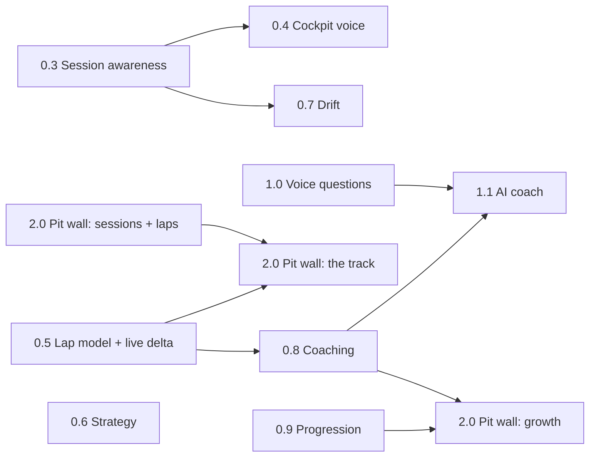

# Roadmap

Where Those Who Run is going and in what order. GitHub milestones and issues
are the source of truth for the details: each item below links to its
milestone, and every open issue carries a `stream:` label so a stream can be
worked on its own.

Last reviewed 2026-10-16, at release 0.3.2.

## Principles

1. **Own car only.** GT7 sends nothing about other cars, flags, penalties,
   weather or tyre wear. Every feature works from our own car's telemetry, or
   it is not on the list.
2. **Voice first, eyes on the road.** In VR the engineer is the HUD: never talk
   mid-corner, never repeat the same sentence.
3. **Numbers before words.** Measurements are computed deterministically and
   tested on real recordings. AI only phrases, prioritises and answers, and
   never invents a number.
4. **Local first.** Everything runs in the home lab; a cloud model is optional
   and off by default.
5. **Pinned by a recording.** A behaviour ships with a fixture from a real
   drive.

## Streams

Streams move in parallel. The hand-offs between them are few and are shown in
the graph.

| Stream | Label | Milestones |
|---|---|---|
| Session awareness | `stream: session` | [0.2 Race awareness](https://github.com/those-who-run/those-who-run/milestone/2), [0.3 Session awareness](https://github.com/those-who-run/those-who-run/milestone/7) |
| A. Engineer voice | `stream: voice` | [0.4 Cockpit voice](https://github.com/those-who-run/those-who-run/milestone/10), [0.7 Drift](https://github.com/those-who-run/those-who-run/milestone/9) |
| B. Lap model and coaching | `stream: coaching` | [0.5 Lap model and live delta](https://github.com/those-who-run/those-who-run/milestone/3), [0.8 Coaching](https://github.com/those-who-run/those-who-run/milestone/11), [1.1 AI coach](https://github.com/those-who-run/those-who-run/milestone/13) |
| C. Pit wall and progression | `stream: pit wall` | [2.0 Pit wall](https://github.com/those-who-run/those-who-run/milestone/6) (phased), [0.9 Progression](https://github.com/those-who-run/those-who-run/milestone/12) |
| D. Strategy | `stream: strategy` | [0.6 Strategy](https://github.com/those-who-run/those-who-run/milestone/4) |
| E. Conversation | `stream: conversation` | [1.0 Voice questions](https://github.com/those-who-run/those-who-run/milestone/5) |
| Ops | `stream: ops` | [Polish and ops](https://github.com/those-who-run/those-who-run/milestone/14), ongoing |

Milestone numbers give a rough order of the themes, not the release versions.
Releases follow semver as work lands: the race feed shipped in 0.3.1, and the
timed-race finish in 0.3.2.

## Order

- **Now:** recordings from the checklist close 0.2 (a mid-race network drop)
  and most of 0.3 (grid start, the unnamed mode, one session of each kind). Then
  drift detection (#65).
- **Next, in parallel:** 0.4 Cockpit voice (stream A) and 0.5 Lap model
  (stream B), with pit wall phase 1 (#33) alongside, since it only reads what
  is already stored.
- **Then:** 0.8 Coaching, pit wall phase 2, and 0.6 Strategy once a long race
  with a stop has been recorded.
- **Later:** 0.9 Progression, 1.0 Voice questions, 1.1 AI coach, and 0.7 Drift
  callouts.

## Milestones

- **[0.4 Cockpit voice](https://github.com/those-who-run/those-who-run/milestone/10)**, the engineer as a HUD replacement:
  - extended telemetry (GT7's "~" packets: steering angle, body acceleration,
    traction-aid flags)
  - a timing gate so callouts wait for a straight
  - verbosity profiles by session kind
  - traction-aid and rev-limiter calls
  - a state-of-the-race bundle
- **[0.5 Lap model and live delta](https://github.com/those-who-run/those-who-run/milestone/3)**:
  - distance along the track
  - reference laps
  - corner names per track
  - live delta
- **[0.6 Strategy](https://github.com/those-who-run/those-who-run/milestone/4)**:
  - tyre wear from tyre radius
  - fuel saving target
  - pit-stop detection
  - tyre drop-off trend
  - stop now or later
- **[0.7 Drift](https://github.com/those-who-run/those-who-run/milestone/9)**: drift callouts and drift results on the card, after
  detection in 0.3.
- **[0.8 Coaching](https://github.com/those-who-run/those-who-run/milestone/11)**, against your own best:
  - lockups and wheelspin
  - spins and big hits
  - braking points
  - minimum and exit speeds
  - theoretical best and consistency
  - a post-session debrief
- **[0.9 Progression](https://github.com/those-who-run/those-who-run/milestone/12)**:
  - personal-best ledger per car and track
  - goals
  - PB cards
  - weekly digest
  - optional break reminder
- **[1.0 Voice questions](https://github.com/those-who-run/those-who-run/milestone/5)**:
  - wake word and local speech to text
  - deterministic answers, Ollama for the rest
  - Discord slash commands
  - "say that again"
- **[1.1 AI coach](https://github.com/those-who-run/those-who-run/milestone/13)**: a model turns 0.8's measured data into advice:
  - coach's notes after a session
  - one practice tip between laps
  - a pre-session plan
  - `@coach` questions in Discord

  Every number is checked against the data before it is said, with the
  deterministic debrief as the fallback. It starts on the home-lab Ollama; a
  hosted model is optional.
- **[2.0 Pit wall](https://github.com/those-who-run/those-who-run/milestone/6)**, a Streamlit app on the LAN, in phases:
  1. Sessions, laps and lap compare (#33). Needs nothing new.
  2. The track: racing line, delta trace, corner table (#117, #34). Needs 0.5.
  3. Growth over weeks (#118). Needs 0.8 and 0.9.
  4. Housekeeping: retention and export (#36).

  A lap summary table written at lap close (#115) keeps it fast. Results cards
  will link to their session page (#116).
- **[Polish and ops](https://github.com/those-who-run/those-who-run/milestone/14)**:
  - image size and warnings
  - phrasing and voices
  - External Secrets for the token
  - per-car overrides
  - upstreaming the gt-telem "~" fix

## Open decisions

- Pit wall access: LAN only like the other home-lab apps (current
  assumption), or behind a login.
- AI coach: local model only, or allow an optional hosted model. Planned as
  local by default, with hosted as an opt-in setting, to be decided after the
  evaluation set (#114).
- Whether to keep the break reminder (#107) and the weekly digest (#106).
