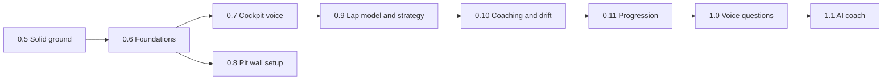

# Roadmap

Where Those Who Run is going and in what order. GitHub milestones and issues
are the source of truth for the details. Each milestone is a release, each
release below links to its milestone, and every open issue carries a `stream:`
label so a stream can be worked on its own. The
[project board](https://github.com/users/ciaranRoche/projects/2) shows the same
releases: a board for the current release and the next one, and a table of
everything open.

Last reviewed 2026-10-18, after the UI decision (ADR 0003), when 0.6 was cut
down to the MVP and the rest of its foundations moved to the release that
first needs each one. The previous review was on 2026-10-17, at release
0.4.0, after a code review and an architecture review of the same day.

## Principles

1. **Own car only.** GT7 sends nothing about other cars, flags, penalties,
   weather or tyre wear. Every feature works from our own car's telemetry, or
   it is not on the list.
2. **Voice first, eyes on the road.** In VR the engineer is the HUD: never talk
   mid-corner, never repeat the same sentence.
3. **Numbers before words.** Measurements are computed deterministically and
   tested on real recordings. AI only phrases, prioritises and answers, and
   never invents a number.
4. **Local first.** Everything runs in the home lab; a cloud model is optional
   and off by default.
5. **Pinned by a recording.** A behaviour ships with a fixture from a real
   drive.

## Releases

From 0.5 on, each milestone is a minor release, cut when its issues are
closed; fixes in between ship as patch releases. A release depends only on the
ones before it (checked against every issue's "Blocked by" line on
2026-10-17).

| Release | What it delivers |
|---|---|
| [0.5 Solid ground](https://github.com/those-who-run/those-who-run/milestone/19) | The bugs from the code review fixed, including the stored best lap (#185). Guardrails: `make check` with type checking, reproducible builds, release checks, deterministic tests, gzipped fixtures. The pit wall on the NUC (#35), after the data and network decisions (#194). An archive for the outings specs rely on (#197). |
| [0.6 Foundations](https://github.com/those-who-run/those-who-run/milestone/20) | **The MVP.** CLI modules, a runtime object and an API server on the engineer's event loop (#171, #172, #173). The pit wall moves to React: a read-only data API that proxies the engineer (#236), the web app scaffold (#237), and the port that retires Streamlit (#238), per [ADR 0003](docs/adr/0003-ui-stack.md). Sessions that stay right through a pause (#229) and a restart on lap 1 (#157). Our own GT7 decoder in place of gt-telem (#235). |
| [0.7 Cockpit voice](https://github.com/those-who-run/those-who-run/milestone/21) | The engine and speech foundations the cockpit needs: one frame delta and a per-frame context for rules, one lap model and one fuel model, the speech policy layer, structured messages, the audio pipeline and Verbaliser, frame sources, a frame budget, deterministic tests and packages by area. Then the engineer as a HUD replacement in VR, on the session awareness it needs: start type, the unflagged mode, kinematics, track detection through a pit stop; the A-packet flags and extended telemetry; the timing gate, verbosity profiles, traction-aid and rev-limiter calls, the state-of-the-race bundle; phrasing and voices; replay that speaks in real time; raw packet recordings. The first wheel dashboard on a phone or tablet (#240), fed by a live dash stream from the engineer (#239), and the HTTPS decision it needs for an installable dash (#252). |
| [0.8 Pit wall setup](https://github.com/those-who-run/those-who-run/milestone/22) | Set the engineer up from the pit wall: one config schema and settings on the data volume, a control API, PS5 discovery, the PlayStation and Discord setup pages (as React routes, reached through the pit wall's proxy), an admin token, host networking, the token in a Secret, a slimmer engineer image. |
| [0.9 Lap model and strategy](https://github.com/those-who-run/those-who-run/milestone/23) | Engine events, versioned storage, the lap table and index reads for the pit wall. Distance along the track, reference laps, live delta, corner names, reference data on the data volume, the racing line and delta trace on the pit wall; tyre wear and drop-off, the fuel saving target, stop now or later, timed-race strategy, per-car overrides. |
| [0.10 Coaching and drift](https://github.com/those-who-run/those-who-run/milestone/24) | A job runner for after-session work. Corner by corner against your own best: lockups and wheelspin, spins and big hits, braking points, minimum and exit speeds, theoretical best and consistency, the debrief, corner growth on the pit wall; drift detection, callouts and the drift card. |
| [0.11 Progression](https://github.com/those-who-run/those-who-run/milestone/25) | Getting faster over weeks: a personal-best ledger, goals, PB cards, the weekly digest, a break reminder, the pit wall's growth view, retention and export, the Postgres push. |
| [1.0 Voice questions](https://github.com/those-who-run/those-who-run/milestone/5) | Ask the engineer: voice receive and wake word, local speech to text, deterministic answers first, free-form answers through one model gateway (#190), slash-command history queries, "say that again". |
| [1.1 AI coach](https://github.com/those-who-run/those-who-run/milestone/13) | A model turns the measured coaching data into advice: notes after a session, one practice tip between laps, a pre-session plan, `@coach` in Discord. Every number is checked against the data before it is said, with the deterministic debrief as the fallback. A dash layout designer (#241), a placeholder until the dashboards have been used. |
| [Polish and ops](https://github.com/those-who-run/those-who-run/milestone/14) | Ongoing, not a release: test and lint housekeeping, code-review nits, upstream fixes and chores that belong to no release. |

0.8 has nothing waiting on it, so it can run alongside 0.7 and later releases.

## Streams

| Stream | Label | Releases |
|---|---|---|
| Code health | `stream: health` | 0.5, 0.6, the foundations in 0.7 and 0.9, single pieces in 0.8, 0.10 and 1.0, and Polish and ops |
| Session awareness | `stream: session` | 0.7, and drift detection in 0.10 |
| A. Engineer voice | `stream: voice` | 0.7, drift callouts in 0.10 |
| B. Lap model and coaching | `stream: coaching` | 0.9, 0.10, 1.1 |
| C. Pit wall and progression | `stream: pit wall` | 0.5 (deploy), 0.6 (the move to React), 0.8 (setup), 0.9 to 0.11 |
| D. Strategy | `stream: strategy` | 0.9 |
| E. Conversation | `stream: conversation` | 1.0 |
| F. Dashboards | `stream: dashboards` | 0.7 (the dash stream and the first dashboard), 1.1 (the layout designer) |
| Ops | `stream: ops` | 0.7, 0.8, 0.9, and Polish and ops |

## Order

- **Now: 0.5 Solid ground.** The fixes are small and independent, so most can
  go in parallel. `make check` (#161) lands first so every later PR runs the
  same checks. The deployment decisions (#194) come before the pit wall goes
  on the NUC (#35). Outings that specs cite are archived (#197) before the NUC
  prunes them.
- **Next: 0.6 Foundations, the MVP.** In this order: #171, #172, #173 (the
  API server on the event loop), then the data API (#236), the scaffold
  (#237) and the port (#238), which removes Streamlit. In parallel from the
  start: the pause fix (#229), the lap-1 restart (#157, AC1, which waits for a
  recording) and the decoder (#235). If 0.6 has to shrink, #235 goes first.
  Everything after 0.6 is an enhancement.
- **Then:** 0.7 Cockpit voice and 0.8 Pit wall setup in parallel, then 0.9,
  0.10 and 0.11. 0.7 starts with its foundations: packages by area (#195)
  first, while little is in flight, then the engine model (#175, #176, #177,
  then #186 and #187), speech (#179, #180, #181) and frame sources (#182),
  with the frame budget (#196) measuring each step. 0.8 starts with config
  (#191), and 0.9 with storage (#174, #178, then #115 and #183).
- **Later:** 1.0 Voice questions and 1.1 AI coach, the releases that add
  models (local first, through #190).

## Open decisions

- Pit wall access: LAN only like the other home-lab apps (current
  assumption), or behind a login.
- AI coach: local model only, or allow an optional hosted model. Planned as
  local by default, with hosted as an opt-in setting, to be decided after the
  evaluation set (#114).
- Whether to keep the break reminder (#107) and the weekly digest (#106).
- Settings on the NUC (#135, #191): does the environment always win, and which
  keys move from the ConfigMap to the pit wall?
- Speech to text in the engineer's process or as a separate server (#22,
  #190).
- One corner table per track, with stable ids, rather than one per reference
  lap (#94, #193).

## Decided

- Data and network (#194): [ADR 0001](docs/adr/0001-data-and-network.md).
- Where to archive the recordings specs rely on (#197):
  [ADR 0002](docs/adr/0002-outing-archive.md).
- The UI stack (#234): [ADR 0003](docs/adr/0003-ui-stack.md). The UI is a React,
  Vite and TypeScript single-page app served as static files by the pit wall
  pod, with a read-only data API and a proxy to the engineer, and no Node at
  runtime. Streamlit is retired in 0.6 (#238). There are two modes, the pit
  wall and the wheel dashboards.
- Own the GT7 decoder (#235, ADR 0003 point 8): Salsa20 and the packet
  layouts in our own code; gt-telem is dropped in 0.6.
- HTTPS for the pit wall (#252): cert-manager with a home-lab CA (option B).
  Traefik serves `https://pitwall.nuc.home.arpa` and redirects HTTP to it;
  phones and tablets trust the CA once (home-lab
  `manifests/cert-manager/README.md`, the deployment repo). This
  gives #240 the secure context for install and the screen wake lock.

## Milestones before 2026-10-17

Until 2026-10-17 milestones were themes, and their numbers were not versions.
Older issues, comments and PRs still use them. This is where that work went:

| Old milestone | Now |
|---|---|
| 0.3 Session awareness | 0.7 Cockpit voice; drift detection (#65) in 0.10 |
| 0.4 Cockpit voice | 0.7 Cockpit voice |
| 0.5 Lap model and live delta, 0.6 Strategy | 0.9 Lap model and strategy |
| 0.7 Drift, 0.8 Coaching | 0.10 Coaching and drift |
| 0.9 Progression | 0.11 Progression |
| 2.0 Pit wall | Deploy (#35, #116) in 0.5, the move to React (#236, #237, #238) in 0.6, setup in 0.8, the lap table (#115) in 0.9, the track (#117) in 0.9, the corner table (#34) in 0.10, growth (#118), retention (#36) and Postgres (#133) in 0.11 |
| Code health: fixes, Code health: guardrails | 0.5 Solid ground |
| Code health: foundations | 0.6 Foundations; on 2026-10-18 all but #171, #172 and #173 moved on to 0.7, 0.8, 0.9 and 0.10, or to Polish and ops |
| Architecture: building blocks | 0.6 Foundations, except #194 and #197 (0.5), #188 and #192 (0.7), #193 (0.9) and #190 (1.0); on 2026-10-18 the rest moved to 0.7, 0.8 and 0.10 |

Releases so far: the race feed shipped in 0.3.1, the timed-race finish in
0.3.2, and pit-stop detection with pit wall phase 1 in 0.4.0.
