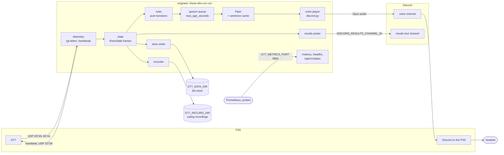
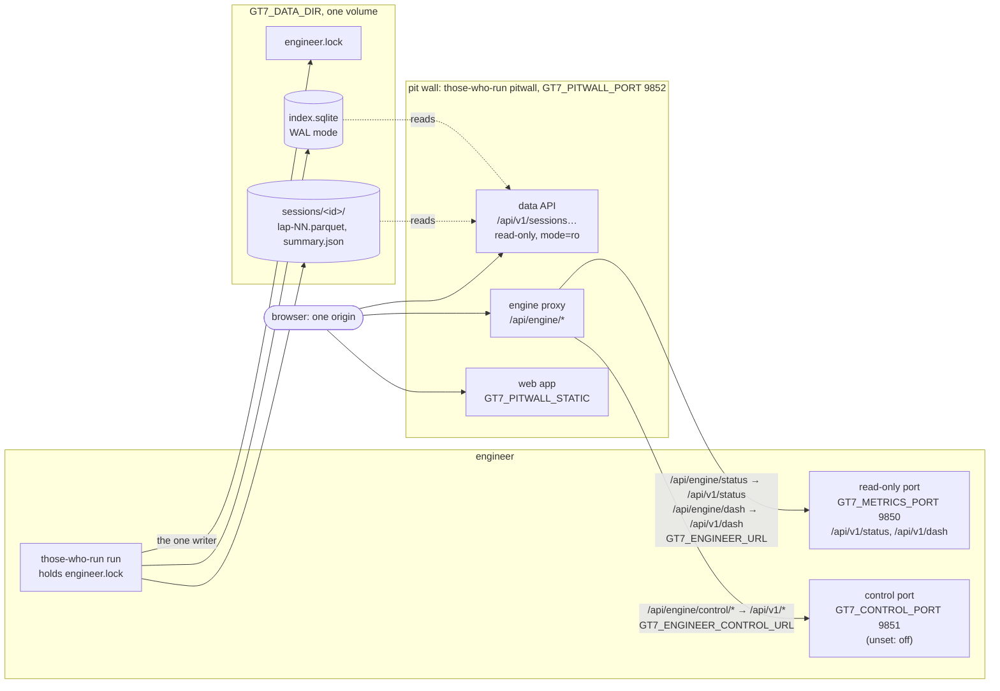
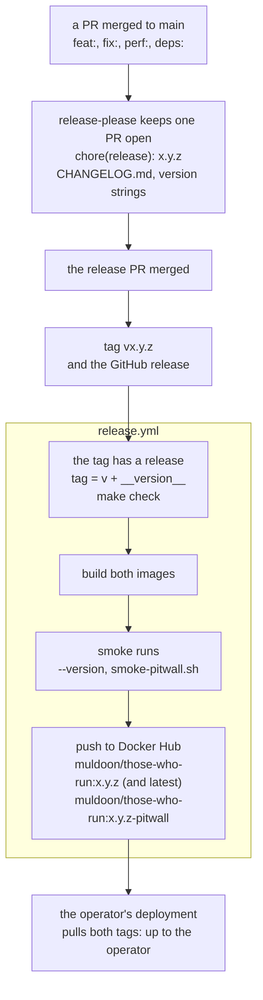

# Architecture

For anyone, person or agent, new to the code: the shape of the system in three
pictures, before the detail in the guides. Back to the [docs index](README.md).

## The engineer

The PS5 streams telemetry to whoever sends it a heartbeat. The engineer turns
each packet into a `RaceState` frame; the rules, which have no I/O, turn
consecutive frames into callouts; the queue drops what is too old to say;
Piper speaks each sentence once and caches it; and discord.py plays the result
into the voice channel the PS5 has joined. Beside the voice, the same frames
feed the results card, the store and the outing recordings, and the read-only
port reports health and metrics. The detail is in
[the engineer guide](engineer.md#how-it-works),
[configuration](setup.md#configuration) and
[metrics](operations.md#metrics); the ports are settled in
[ADR 0001](adr/0001-data-and-network.md).

## The store and the pit wall

The engineer is the store's only writer: `run` holds `engineer.lock` while it
is up, writes each lap's frames to Parquet and then its row to
`index.sqlite`. The pit wall only reads, opening the index `mode=ro` per
request (WAL mode keeps it from holding up the writer). It serves the React
app as static files and proxies the engineer's ports, so the browser talks to
one origin and never to the engineer directly. The detail is in
[the pit wall guide](pitwall.md) ([the data API](pitwall.md#the-data-api),
[the store](pitwall.md#the-store)) and in [ADR 0001](adr/0001-data-and-network.md)
and [ADR 0003](adr/0003-ui-stack.md).

## A release

Merged PRs collect in one release PR, and merging it ships. release-please
tags the merge commit and calls `release.yml`, which runs `make check` on the
tagged commit, builds the engineer's image and the pit wall's, smoke-tests
both, and pushes the two tags. Where and how they run is up to whoever runs
them: [Deploying](operations.md#deploying) says what the two images need (one
data volume, one engineer at a time, and waiting for `/healthz` to say `idle`
before replacing the engineer). The detail is in
[Releasing](operations.md#releasing).
